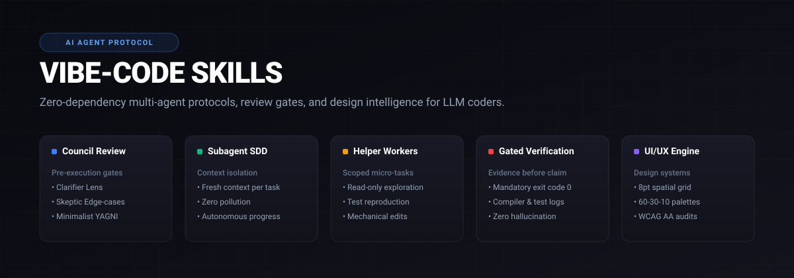

<div align="center">



<br>

**Standardized Multi-Agent Protocols & Skills for Autonomous AI Coding Agents**

[](https://github.com/arvnfly/VIBE-CODE-SKILLS/actions/workflows/ci.yml)
[](LICENSE)
[](https://github.com/arvnfly/VIBE-CODE-SKILLS/pulls)
[](#supported-agents)

*Zero external binaries. 100% portable markdown instructions, multi-lens review gates, design intelligence, and subagent isolation protocols.*

---

[Quickstart](#quickstart) • [Why Vibe-Code?](#why-vibe-code-skills) • [Architecture](#architecture) • [Core Skills](#core-skills) • [Examples](#examples--artifacts) • [Supported Agents](#supported-agents) • [Verification](#verification--testing)

</div>

---

## Why VIBE-CODE Skills?

Autonomous coding agents (Claude Code, Cursor, Antigravity, OpenAI Codex, Windsurf) fail predictably due to four structural pitfalls:

| Common Failure Mode | Without Vibe-Code | With VIBE-CODE Skills |
| :--- | :--- | :--- |
| **Unscoped Execution** | Rushes into code blindly; breaks working modules with speculative abstractions. | **Pre-Execution Council**: Clarifier, Skeptic, and Minimalist lenses define binary acceptance criteria upfront. |
| **Context Pollution** | Reads entire codebase histories into the main context; hallucinations spike. | **Subagent Helpers**: Spawns isolated workers for read-only exploration and reproduction tests. |
| **Premature Completion** | Claims *"I fixed the bug!"* based on conversational optimism without proof. | **Gated Verification**: Strict protocol forbidding task closure without terminal evidence (`exit code 0`). |
| **Guesswork Debugging** | Applies random patches or wraps errors in empty `try/catch` blocks. | **Systematic Debugging**: Enforces a strict 4-phase root-cause investigation cycle before touching code. |
| **Unstyled / Inaccessible UI** | Generates generic, inconsistent CSS with arbitrary spacing, unreadable contrast, and zero accessibility. | **UI/UX Design Engine**: Enforces design systems, 8pt spatial grid, 60-30-10 palettes, fluid typography, and WCAG AA audits. |

---

## Architecture

```
                                      [ USER REQUEST ]
                                             │
                                             ▼
                         ┌───────────────────────────────────────┐
                         │     PRE-EXECUTION COUNCIL GATE        │
                         │  • Clarifier: Binary Criteria (Pass)  │
                         │  • Skeptic: Edge Cases & Blast Radius │
                         │  • Minimalist: YAGNI / Stdlib First   │
                         └───────────────────┬───────────────────┘
                                             │
                                             ▼
                           ┌───────────────────────────────────┐
                           │ SUBAGENT-DRIVEN DEVELOPMENT (SDD) │
                           │    (Sequential Fresh Subagents)   │
                           └─────────────────┬─────────────────┘
                                             │
                         ┌───────────────────┼───────────────────┐
                         │                   │                   │
                         ▼                   ▼                   ▼
           ┌───────────────────────────┐   ┌───────────────────────────┐   ┌───────────────────────────┐
           │   SUBAGENT-HELPER WORKER  │   │   SYSTEMATIC DEBUGGING    │   │    UI/UX DESIGN ENGINE    │
           │  • Read-Only Symbol Map   │   │  1. Reproduce (100%)      │   │  • Design Systems & Tokens│
           │  • Isolated Test Scripts  │   │  2. Trace to Origin       │   │  • Responsive Layouts     │
           │  • Mechanical Refactors   │   │  3. Form Hypothesis       │   │  • WCAG 2.2 AA Audits     │
           │                           │   │  4. Minimal Targeted Patch│   │  • Micro-Interactions     │
           └─────────────┬─────────────┘   └─────────────┬─────────────┘   └─────────────┬─────────────┘
                         │                               │                               │
                         └───────────────────────────────┼───────────────────────────────┘
                                                         │
                                                         ▼
                         ┌───────────────────────────────────────┐
                         │       GATED VERIFICATION BARRIER      │
                         │  • Real terminal execution required   │
                         │  • Exit code MUST be 0                │
                         │  • Evidence logged before completion  │
                         └───────────────────┬───────────────────┘
                                             │
                                             ▼
                         ┌───────────────────────────────────────┐
                         │    POST-EXECUTION COUNCIL AUDIT       │
                         │  • Correctness: Criteria verified     │
                         │  • Security: Sanitization & leaks     │
                         │  • Architecture: Diff hygiene         │
                         └───────────────────┬───────────────────┘
                                             │
                                             ▼
                                 [ VERIFIED DELIVERABLE ]
```

---

## Quickstart

Install VIBE-CODE Skills into any existing project in 3 seconds:

### Via NPX (Direct from GitHub or NPM)

Run instantly without cloning or local installation:

```bash
# Run directly from GitHub repository (no npm registry wait)
npx github:arvnfly/VIBE-CODE-SKILLS

# Or via npm package (once published):
npx vibe-code-skills
```

### CLI Commands & Advanced Flags

The native zero-dependency CLI includes workspace auto-detection, client filtering, diagnostic health checks, and dry-run safety:

```bash
# Universal install into current project (auto-detects active agents)
npx github:arvnfly/VIBE-CODE-SKILLS install

# Install into a specific directory
npx github:arvnfly/VIBE-CODE-SKILLS install /path/to/project

# Filter installation to a specific AI agent:
# Options: antigravity, claude, cursor, codex, windsurf, omp, gemini, aider, copilot
npx github:arvnfly/VIBE-CODE-SKILLS install ./my-project --client=cursor

# Preview file operations without modifying disk
npx github:arvnfly/VIBE-CODE-SKILLS install ./my-project --dry-run

# Create a timestamped backup before overwriting files
npx github:arvnfly/VIBE-CODE-SKILLS install ./my-project --backup

# Audit project configuration and verify skill health
npx github:arvnfly/VIBE-CODE-SKILLS doctor ./my-project

# Run multi-agent contract verification test suite
npx github:arvnfly/VIBE-CODE-SKILLS verify

# List all core skills and supported AI agent platforms
npx github:arvnfly/VIBE-CODE-SKILLS list

# Safely remove vibe-code skills without touching user code
npx github:arvnfly/VIBE-CODE-SKILLS uninstall ./my-project
```

### One-Line Shell Installers

#### Linux / macOS:
```bash
curl -fsSL https://raw.githubusercontent.com/arvnfly/VIBE-CODE-SKILLS/main/install.sh | bash
```

#### Windows (PowerShell):
```powershell
irm https://raw.githubusercontent.com/arvnfly/VIBE-CODE-SKILLS/main/install.ps1 | iex
```

### Manual Install / Git Clone:
```bash
# Clone the repository
git clone https://github.com/arvnfly/VIBE-CODE-SKILLS.git

# Install into your target project
./VIBE-CODE-SKILLS/install.sh /path/to/your/project
# Or on Windows:
.\VIBE-CODE-SKILLS\install.ps1 -Destination "C:\path\to\your\project"
```

---

## Core Skills

All skills adhere to the standard open Agent Skill format (`SKILL.md`) with YAML frontmatter.

### 1. `subagent-council`
*Location: `skills/subagent-council/SKILL.md`*
- **Mode 1: Prompt Review (Pre-Execution Gate)**: Dissects complex instructions into measurable acceptance criteria using **Clarifier**, **Skeptic**, and **Minimalist** lenses.
- **Mode 2: Project Review (Post-Execution Audit)**: Audits resulting code diffs against **Correctness**, **Security**, and **Architecture** before work is closed.

### 2. `subagent-helper`
*Location: `skills/subagent-helper/SKILL.md`*
- **Exploration (Read-Only)**: Offloads symbol lookup and file inspection to keep the main agent's context clean.
- **Isolated Test Generation**: Writes standalone reproduction test scripts without modifying production code.
- **Mechanical Refactoring**: Executes repetitive batch formatting, schema renaming, or migrations.

### 3. `subagent-driven-development`
*Location: `skills/subagent-driven-development/SKILL.md`*
- Dispatches fresh, isolated subagents per task to eliminate context degradation.
- Enforces council review gates between individual tasks.
- Promotes continuous autonomous execution without trivial interruptions.

### 4. `verification-before-completion`
*Location: `skills/verification-before-completion/SKILL.md`*
- **Absolute Rule**: Evidence before assertions.
- Requires literal terminal command logs with `exit code 0` (compiler, test suite, or linter).
- Zero tolerance for conversational claims of success without verifiable proof.

### 5. `systematic-debugging`
*Location: `skills/systematic-debugging/SKILL.md`*
- 4-phase investigation protocol: **Reproduce** &rarr; **Trace** &rarr; **Hypothesize** &rarr; **Minimal Fix**.
- Strictly prohibits speculative guessing or suppressing exceptions.

### 6. `ui-ux`
*Location: `skills/ui-ux/SKILL.md`*
- Complete design intelligence engine for web, mobile, and desktop interfaces.
- Design systems, 8pt spatial grid, semantic color tokens (60-30-10 distribution rule), fluid typography scales, visual archetype selection matrix (Clean SaaS, Bento Grid, Dark Mode, Neo-Brutalism), responsive breakpoints, micro-interactions, and WCAG 2.2 AA accessibility pre-flight audits.

---

## Examples & Artifacts

Real-world artifacts demonstrating how skills operate during development tasks:

| Example | Domain | Covered Skills | Description |
| :--- | :--- | :--- | :--- |
| [01-full-stack-task](examples/01-full-stack-task/) | Full-Stack Auth | `subagent-driven-development`, `subagent-council`, `verification-before-completion` | Multi-phase checklist tracker ([task.md](examples/01-full-stack-task/task.md)) and pre/post-execution review artifacts ([council-review.md](examples/01-full-stack-task/council-review.md)). |
| [02-ui-ux-refactor](examples/02-ui-ux-refactor/) | Design System Refactor | `ui-ux` | Direct before-and-after code transformation ([before-and-after.md](examples/02-ui-ux-refactor/before-and-after.md)) applying the 8pt grid, semantic color tokens, and WCAG AA contrast. |
| [03-systematic-debugging](examples/03-systematic-debugging/) | Root Cause Analysis | `systematic-debugging` | 4-phase investigation report ([investigation-report.md](examples/03-systematic-debugging/investigation-report.md)) diagnosing and resolving a token expiration race condition. |

---

## Supported Agents

VIBE-CODE Skills automatically maps to every major coding agent:

| Agent / Client | Config Path | Integration Method |
| :--- | :--- | :--- |
| **Google Antigravity** | `AGENTS.md`, `.agent/skills/` | Native Antigravity skill system and agent rules |
| **Claude Code** | `CLAUDE.md`, `.claude/commands/`, `.claude/skills/` | Slash commands (`/council`, `/helper`) and project guidelines |
| **Cursor** | `.cursorrules`, `.cursor/rules/council.mdc` | Project rules and MDC always-apply instructions |
| **Windsurf** | `.windsurfrules` | Workspace rules and memory directives |
| **OpenAI Codex** | `CODEX.md`, `.codex-plugin/plugin.json` | Project instructions and plugin metadata |
| **Oh My Pi (omp)** | `PI.md`, `.omp/skills/`, `.omp/commands/` | Native CLI commands and skill engine |
| **Gemini CLI** | `GEMINI.md`, `gemini-extension.json` | Extension manifest and context rules |
| **Aider** | `.aider.conf.yml`, `.aider/CONVENTIONS.md` | Auto-loaded configuration and conventions |
| **GitHub Copilot** | `.github/copilot-instructions.md` | Repository-wide custom instructions |

---

## Anti-Slop Principles

1. **YAGNI & Stdlib First**: No factories for single products, no unrequested abstractions, and no third-party libraries for what standard libraries can do.
2. **Minimal Blast Radius**: Touch only lines and files directly required to fulfill the user request.
3. **Explicit Confirmation**: Never execute destructive operations (database drops, disk wipes, git resets) without explicit user sign-off.
4. **Clean Diff Hygiene**: Eliminate debug logs, temporary scratch files, and dead code before committing.

---

## Verification & Testing

This repository includes continuous automated verification for all schemas, skills, and installers:

```bash
# Run local validation suite
npm test
```

Expected output:
```
--- 1. Validating JSON Manifests ---
PASS: package.json is valid JSON
...

--- 2. Validating Platform Entrypoints & Root Files ---
PASS: All platform rules and entrypoints exist

--- 2b. Validating Concrete Walkthrough Examples ---
PASS: All example artifacts verified

--- 3. Validating Core Skills Structure & Frontmatter ---
PASS: All 6 skills verified across all client directories

--- 4. Checking Clean Universal English ---
PASS: All content verified for universal English language

All checks passed! Repository is 100% valid and verified.

=== Running Multi-Agent Contract Simulation Tests ===
PASS: Council Mode 1 sample conforms to pre-execution gate schema
PASS: Council Mode 2 sample conforms to post-execution audit schema
PASS: Valid terminal verification report passes gate
PASS: Primary text contrast 18.33:1 exceeds WCAG AAA standard (7:1)
PASS: Muted text contrast 7.48:1 meets WCAG AA standard (4.5:1)
PASS: All spatial scale tokens strictly adhere to 8pt/4pt subgrid cadence
PASS: Systematic debugging report conforms to 4-phase contract

All agent contract simulation tests passed cleanly!
```

---

## Contributing

Contributions are welcome:
1. Fork the repository.
2. Ensure any new skill includes a valid `SKILL.md` with YAML frontmatter.
3. Run `npm test` to verify all checks pass.
4. Submit a pull request.

---

## License

[MIT](LICENSE) (c) [rayz](https://github.com/arvnfly)